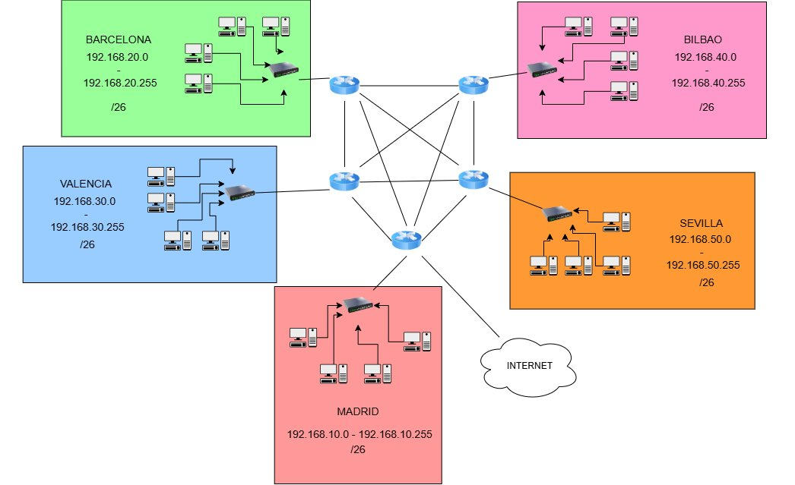
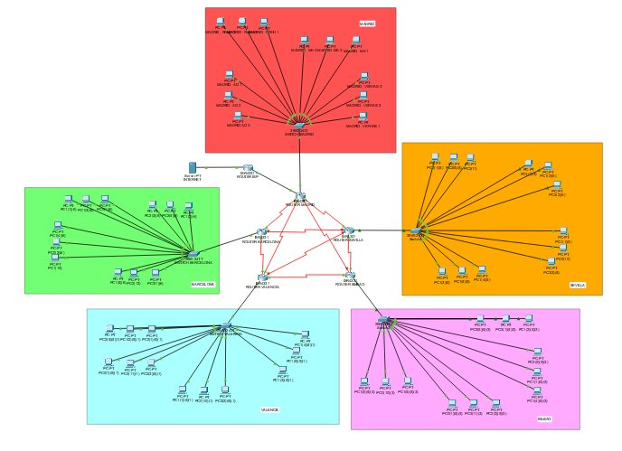
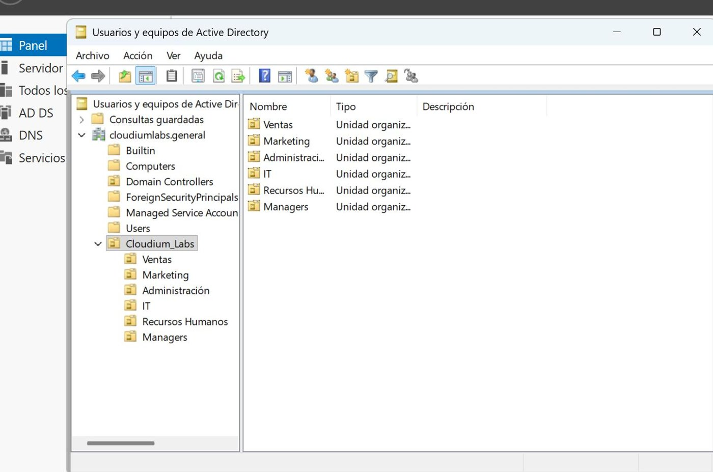
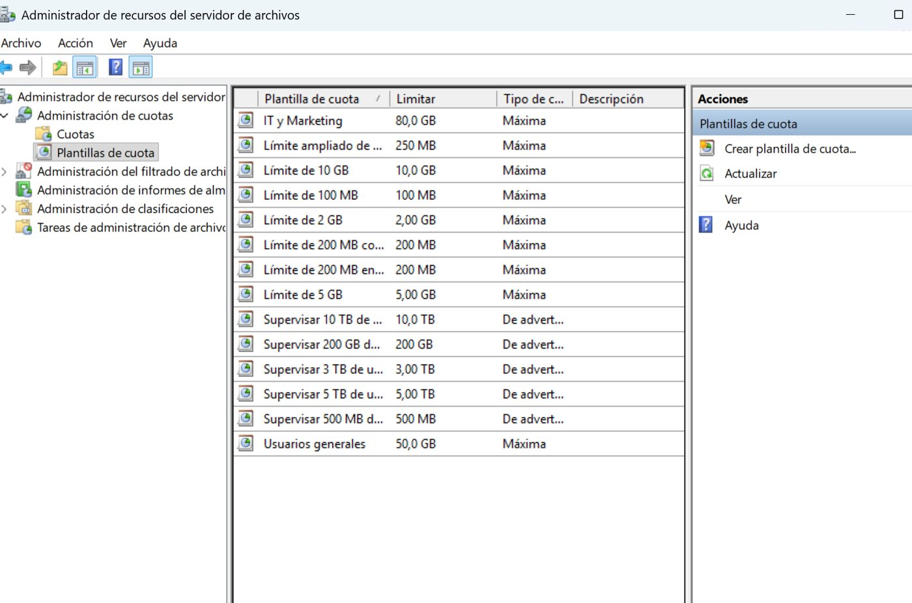
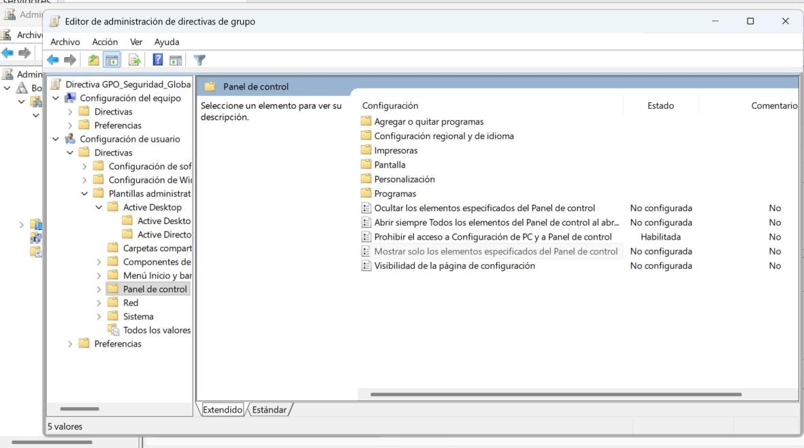
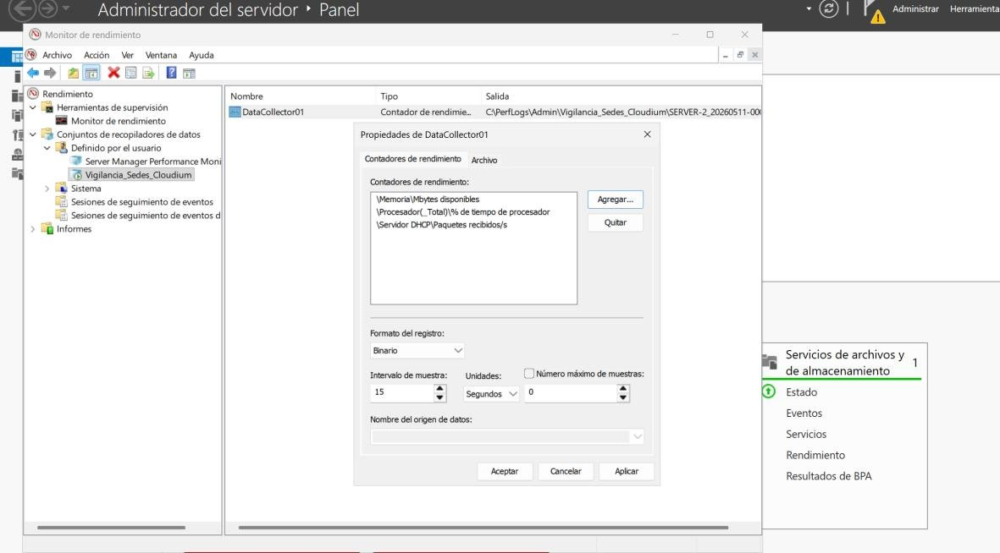

# 🌐 Cloudium Labs — Renovación integral de red y sistemas

**Diseño e implementación de la infraestructura de una empresa de 400 empleados repartida en 5 sedes: red multisede con VLAN, OSPF, ACL y NAT, más un dominio de Active Directory con GPO, cuotas, permisos NTFS, controlador de dominio adicional, monitorización y despliegue de maquetas con Sysprep.**

Proyecto intermodular · 1º ASIR · 3.er trimestre (curso 2025/26) · Raúl Yagüe y Daniel Arias

---

## 📌 El caso

**Cloudium Labs S.L.** (cliente ficticio) encarga a la consultora **Nexora Tech** renovar una infraestructura con problemas reales de auditoría: red plana sin segmentar, gestión de usuarios descentralizada y un incidente en el que **Marketing accedió a datos de Finanzas**. El objetivo: una infraestructura **segura, centralizada y escalable** para 400 empleados en **Madrid (sede central), Barcelona, Valencia, Bilbao y Sevilla**.

## 🧩 Qué se ha hecho

### 1 · Red multisede (Cisco Packet Tracer)

| Área | Implementación |
|---|---|
| **Direccionamiento** | Un bloque `192.168.X.0/24` por sede (`X` = 10, 20, 30, 40, 50) dividido en **4 subredes /26** de 62 hosts |
| **Segmentación** | **VLAN 10/20/30/40** (Ventas, Marketing, Administración, RR. HH.) con puertos de acceso y *trunk* |
| **Inter-VLAN** | *Router-on-a-stick* con subinterfaces `802.1Q` en cada router de sede |
| **WAN** | Enlaces serie punto a punto en `10.0.0.0/30`, en anillo entre las 5 sedes |
| **Enrutamiento** | **OSPF** entre sedes: si cae un enlace, las rutas se recalculan solas por el camino alternativo |
| **Aislamiento** | **ACL** en los routers: cada departamento solo habla con su misma VLAN entre sedes |
| **DHCP** | Pools por VLAN en cada router de sede |
| **Salida a Internet** | **NAT con sobrecarga (PAT)** centralizado en Madrid, hacia un servidor DNS/HTTP que simula Internet |
| **Hardening** | Contraseñas de acceso privilegiado en todos los routers y switches |

<b>📋 Plan de direccionamiento</b>

| VLAN | Red | Rango útil | Broadcast | Máscara |
|---|---|---|---|---|
| 10 | `192.168.X.0` | `.1 – .62` | `.63` | `/26` |
| 20 | `192.168.X.64` | `.65 – .126` | `.127` | `/26` |
| 30 | `192.168.X.128` | `.129 – .190` | `.191` | `/26` |
| 40 | `192.168.X.192` | `.193 – .254` | `.255` | `/26` |

| Enlace WAN | Red | Extremos |
|---|---|---|
| Madrid ↔ Barcelona | `10.0.0.0/30` | `.1` ↔ `.2` |
| Barcelona ↔ Valencia | `10.0.0.4/30` | `.5` ↔ `.6` |
| Valencia ↔ Bilbao | `10.0.0.8/30` | `.9` ↔ `.10` |
| Bilbao ↔ Sevilla | `10.0.0.12/30` | `.13` ↔ `.14` |
| Sevilla ↔ Madrid | `10.0.0.16/30` | `.17` ↔ `.18` |

### 2 · Sistemas y directorio (Windows Server) — *mi parte principal*

- **Bosque y dominio únicos** `cloudiumlabs.general` (espacio interno separado del público `cloudiumlabs.com` para evitar *split-brain DNS*).
- **DNS integrado en AD** con zonas directa e inversa, y **DHCP** en el servidor para el segmento `/23`.
- **Árbol de OU** departamental (Ventas, Marketing, Administración, IT, RR. HH., Managers) con usuarios y grupos de seguridad.
- **GPO de hardening**: bloqueo del Panel de Control y de Configuración de Windows a usuarios estándar, y **fondo de pantalla corporativo** servido desde un recurso compartido protegido con NTFS.
- **FSRM**: plantillas de **cuota dura** (50 GB plantilla general, 80 GB perfiles avanzados) para que nadie llene el almacenamiento.
- **Permisos NTFS + ABE** (*Access-Based Enumeration*): denegación explícita fuera del grupo de seguridad y carpetas invisibles para quien no tiene permiso. Corrige el incidente Marketing → Finanzas.
- **Alta disponibilidad**: `SERVER-2` promovido a **controlador de dominio adicional** con replicación DFS-R.
- **Monitorización proactiva** con el Monitor de rendimiento: conjunto de recopiladores `Vigilancia_Sedes_Cloudium` (CPU, memoria disponible, red, disco).
- **Maquetas de cliente** selladas con **Sysprep** e instalación desatendida con `unattended.xml`, con unión automática al dominio.

<table>
  <tr>
    <td></td>
    <td></td>
  </tr>
  <tr>
    <td align="center">Árbol de OU en <code>cloudiumlabs.general</code></td>
    <td align="center">Plantillas de cuota en FSRM</td>
  </tr>
  <tr>
    <td></td>
    <td></td>
  </tr>
  <tr>
    <td align="center">GPO de restricción del Panel de Control</td>
    <td align="center">Recopiladores de datos en PerfMon</td>
  </tr>
</table>

### 3 · Hardware, seguridad física y costes

Selección justificada de equipos de oficina y de teletrabajo por departamento, equipamiento de red y servidores, protocolo de **alta y baja de usuarios**, estrategia de copias **3-2-1** y presupuesto total del despliegue.

## ✅ Validación

| ID | Prueba | Resultado |
|---|---|---|
| CPPAR01 | Acceso a la configuración de routers y switches protegido por contraseña | ✔️ |
| CPPAR02 | Ping entre sedes **en la misma VLAN** | ✔️ responde |
| CPPAR03 | Ping entre sedes **en VLAN distinta** | ✔️ bloqueado por ACL |
| CPPAR04 | Navegación al servidor web "de Internet" a través del NAT | ✔️ |
| CP-ISO-01 | Usuario estándar sin acceso al Panel de Control | ✔️ |
| CP-ISO-02 | Cuotas aplicadas en carpetas departamentales | ✔️ |
| CP-ISO-03 | Maqueta desplegada y unida al dominio automáticamente | ✔️ |

Además: **matriz de 15 riesgos** con plan de mitigación, requisitos funcionales y no funcionales, y planificación con diagrama de Gantt.

## 🔭 Siguientes pasos propuestos

- Identidad híbrida con **Microsoft Entra ID**.
- **VPN site-to-site** cifrada entre sedes.
- **MDM** para dispositivos móviles corporativos.
- Evolución hacia un modelo **Zero Trust**.

## 👥 Reparto

| Persona | Responsable de |
|---|---|
| **Raúl Yagüe** | Active Directory (OU, usuarios y grupos), GPO, FSRM, NTFS + ABE, DC adicional, monitorización, maquetas con Sysprep |
| **Daniel Arias** | Red multisede (VLAN, OSPF, ACL, DHCP, NAT), cableado y selección de hardware |

---

© Raúl Yagüe y Daniel Arias · Memoria técnica de 160 páginas disponible bajo petición

